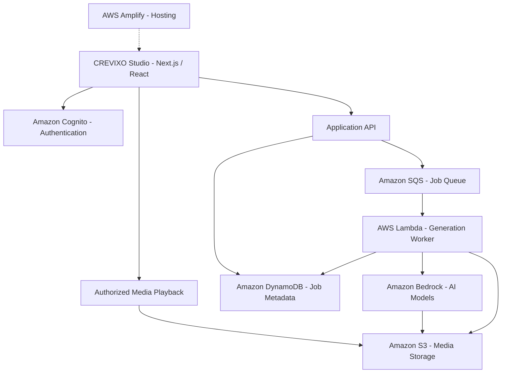

# 🎬 CREVIXO — Private AI Content Studio

### AI-Powered Creative Production | AWS Cloud Engineering | Full-Stack Development

**Developed by SolaceNova Technologies Ltd**

**Project Status:** Active Development & Integration Testing

CREVIXO is a private, cloud-based AI creative production platform designed to bring film production, video generation, podcasting, music production, and content automation into one unified workspace.

The project combines AWS serverless infrastructure, generative AI, secure authentication, media processing, and modern full-stack development.

> **Portfolio Notice:** CREVIXO is an active engineering project. Some components have been individually tested, while full end-to-end production functionality remains under development and validation.

---

## 🚀 Project Vision

CREVIXO aims to provide a professional creative production environment supporting:

- 🎬 AI-assisted movie and series production
- 🎥 Text-to-video generation workflows
- 🎙️ Podcast recording and audio production
- 🎵 Music editing, mixing, and mastering
- 🧑‍🎤 Character identity and cast management
- 📺 YouTube and social media production workflows
- 🤖 AI work agents and content automation
- 📝 Screenwriting, storyboarding, and shot planning
- 🔊 Voice production and dialogue workflows
- ☁️ Secure cloud storage and media recovery
- 📱 Responsive mobile and desktop workspaces

The long-term goal is to connect these capabilities into a unified, reliable creative production platform.

---

## 🛠️ Technology Stack

| Category | Technologies |
|---|---|
| Frontend | Next.js, React, TypeScript |
| Backend | Node.js, AWS Lambda |
| Cloud Platform | Amazon Web Services |
| Generative AI | Amazon Bedrock |
| Video Generation | Amazon Nova / Luma Ray workflows |
| Authentication | Amazon Cognito |
| API | Next.js API routes and serverless services |
| Job Queue | Amazon SQS |
| Database | Amazon DynamoDB |
| Storage | Amazon S3 |
| Hosting | AWS Amplify, Vercel |
| Media Processing | FFmpeg |
| Version Control | Git, GitHub |
| Development | VS Code, GitHub Codespaces |
| Testing | TypeScript checks, integration and security tests |

---

## ☁️ AWS Cloud Architecture

CREVIXO uses AWS services to support asynchronous media generation, application services, and secure storage.

### AWS Services

| AWS Service | Engineering Purpose |
|---|---|
| Amazon Bedrock | Generative AI model integration |
| AWS Lambda | Serverless generation workers |
| Amazon SQS | Asynchronous job processing |
| Amazon DynamoDB | Job records and production metadata |
| Amazon S3 | Media output and artifact storage |
| Amazon Cognito | User authentication |
| AWS Amplify | Application hosting |
| AWS IAM | Access control and permissions |

### CREVIXO AWS Architecture Diagram

*Simplified architecture illustrating CREVIXO's generation workflow. Full end-to-end production integration remains under validation.*

---

## 🎥 Generation Workflow

The intended generation workflow follows these stages:

1. A user creates a production request inside CREVIXO.
2. The application validates and submits the request.
3. Amazon SQS queues the generation job.
4. An AWS Lambda worker processes the job.
5. The worker invokes an approved AI generation model.
6. Generation status and metadata are managed through DynamoDB.
7. Media outputs are stored in Amazon S3.
8. Authorized users retrieve and review generated media.
9. Approved outputs move into the production timeline.
10. Completed productions can be prepared for export and publishing.

The system is designed to separate interactive application requests from longer-running generation tasks.

---

## 🎬 Movie & Series Production Studio

The planned production workspace includes:

- Movie and series project management
- Screenplay and script development
- Scene and shot breakdowns
- AI-assisted storyboarding
- Character and cast identity references
- Dialogue and actor voice workflows
- Video generation job management
- Scene sequencing and timeline editing
- Media playback and export
- Production history and recovery

### Production Projects

**Night Extraction**

A cinematic action-thriller production project used to explore screenplay-to-shot workflows, scene continuity, dialogue, and video generation.

**CHRONO-BREAK: PRIMAL VOID**

A science-fiction action series concept exploring recurring characters, consistent visual identities, cinematic sequences, and episodic production.

These projects provide practical test cases for CREVIXO's developing production tools.

---

## 🎙️ Podcast Production Studio

CREVIXO includes an evolving podcast production workspace.

### The Global Lounge

**Presenters:** Adrian Cole and Naomi Blake

The podcast workspace is designed to support:

- Episode planning and research
- Presenter profiles and identity references
- Script and show-note preparation
- Audio recording
- Multi-track mixing
- Audio playback
- WAV export
- Production asset management
- Mobile-friendly editing

Recording, mixing, playback, and export functionality require continued integration and device-level validation.

---

## 🎵 Music & Audio Studio

CREVIXO's audio development focuses on bringing music-production capabilities into the same creative workspace.

Planned and developing features include:

- Audio recording
- Multi-track editing
- Beat sequencing
- Audio mixing
- Volume and balance controls
- Timeline editing
- WAV processing
- Long-form audio handling
- Export preparation
- Voice processing workflows

Development work has included long-audio processing and mixer validation.

Advanced mastering and complete professional digital audio workstation functionality remain future development goals.

---

## 🤖 AI Work Agents & Automation

CREVIXO is being designed to assist with repeatable content-production tasks.

Planned automation capabilities include:

- Content idea generation
- Research and script drafting
- Production scheduling
- Asset organization
- Channel-specific production queues
- Publishing preparation
- Content metadata and hashtags
- Production progress monitoring
- Approval workflows

**Publishing Policy:** Paid generation and public publishing should require explicit owner approval.

Automated publishing depends on successful platform integration, authorization, and production testing.

---

## 🔐 Security & Access Control

Security is an important part of CREVIXO's architecture.

Engineering work includes:

- Amazon Cognito authentication
- AWS IAM permission management
- Owner-restricted application access
- Protected API requests
- Authorized media playback
- Server-side validation
- Signed media access workflows
- Controlled S3 object access
- Recovery and job verification checks
- Fail-closed handling of invalid records

The private owner workspace is designed to restrict access to authorized users.

Security validation is ongoing and does not represent a claim of independent security certification.

---

## 🧪 Engineering & Validation

CREVIXO has been developed through incremental implementation, testing, and recovery work.

### Demonstrated Engineering Milestones

- AWS Lambda generation worker configured
- Amazon SQS generation queue integrated
- DynamoDB job metadata storage established
- Amazon S3 media output storage configured
- Amazon Bedrock generation workflow tested
- Short AI-generated video output produced
- Media duration and resolution inspected using FFprobe
- Server-side media rendering tested
- AWS Amplify hosting deployment tested
- Cognito owner authentication tested
- Secure playback and recovery checks executed
- Integration and release-gate tests executed
- GitHub branches and production release workflows managed

### Validation Status

| Component | Status |
|---|---|
| AWS serverless infrastructure | Implemented and tested in parts |
| SQS job queue | Configured |
| Lambda generation worker | Tested |
| DynamoDB metadata | Configured |
| S3 media storage | Tested |
| Bedrock video generation | Short-output test completed |
| Cognito owner sign-in | Tested |
| Amplify deployment | Tested |
| Media rendering | Test outputs produced |
| Podcast production | Under integration testing |
| Music production | Under development |
| Full movie generation | Not yet end-to-end validated |
| Automated social publishing | Not yet fully connected |
| Commercial multi-user release | Not launched |

These statuses describe engineering milestones, not guarantees of current production availability.

---

## 📱 Responsive Application Development

CREVIXO targets both desktop and mobile workflows.

Development priorities include:

- Responsive navigation
- Mobile-friendly production controls
- Consistent workspace layouts
- Persistent project data
- Autosave and recovery
- Cross-device workspace continuity
- Accessible editing controls
- Secure session handling

Mobile usability and data synchronization remain active areas of development.

---

## 🧩 Engineering Challenges

CREVIXO provides practical experience in solving real-world software engineering problems.

### Asynchronous Processing

AI media generation can take longer than ordinary web requests.

Amazon SQS and AWS Lambda help separate generation jobs from the user interface.

### Media Storage

Generated video and audio assets require durable storage, controlled retrieval, and reliable metadata.

Amazon S3 and DynamoDB support these workflows.

### Secure Access

Private production assets require authentication, authorization, and careful handling of storage permissions.

### Production Recovery

Long-running media jobs can fail or become interrupted.

Recovery checks, job reconciliation, and backup strategies are important engineering priorities.

### Cost Management

AI generation and cloud infrastructure introduce variable operating costs.

The platform is being developed with controlled generation, testing, and resource usage in mind.

---

## 🗺️ Development Roadmap

### Phase 1 — Cloud Foundation

- [x] Establish AWS infrastructure
- [x] Configure generation queue
- [x] Implement Lambda generation worker
- [x] Configure DynamoDB metadata
- [x] Configure S3 media storage
- [x] Test short AI video generation
- [x] Test private owner authentication

### Phase 2 — Production Integration

- [ ] Validate complete screenplay-to-video workflow
- [ ] Complete production timeline integration
- [ ] Improve character consistency
- [ ] Integrate actor dialogue and lip-sync
- [ ] Complete podcast recording and export validation
- [ ] Complete music workspace integration
- [ ] Validate mobile and desktop synchronization
- [ ] Complete backup and recovery testing

### Phase 3 — Publishing & Automation

- [ ] Integrate approved YouTube publishing workflows
- [ ] Connect supported social platforms
- [ ] Complete production approval controls
- [ ] Implement production analytics
- [ ] Validate scheduled publishing
- [ ] Expand AI work agent capabilities

### Phase 4 — Platform Expansion

- [ ] Improve high-resolution video workflows
- [ ] Expand advanced audio production
- [ ] Improve automated production orchestration
- [ ] Strengthen operational monitoring
- [ ] Evaluate commercial multi-user architecture
- [ ] Complete deployment and security readiness reviews

---

## 💼 Skills Demonstrated

This project demonstrates hands-on experience in:

**AWS Cloud Engineering**
- Serverless architecture
- Lambda, SQS, DynamoDB, S3
- Cognito authentication
- IAM permissions
- AWS Amplify deployment

**Full-Stack Development**
- Next.js and React
- TypeScript and JavaScript
- Node.js
- API development
- Responsive application design

**AI Integration**
- Amazon Bedrock
- Generative media workflows
- Asynchronous job orchestration
- AI application integration

**DevOps & Software Delivery**
- Git and GitHub
- Branch management
- Integration testing
- Deployment workflows
- Debugging and recovery

**Security Engineering**
- Authentication
- Authorization
- Secure media access
- Request validation
- Recovery verification

---

## 🔗 Project Links

**Portfolio Repository**

https://github.com/solacecloud/crevixo-portfolio

**Application Development Repository**

https://github.com/solacecloud/ai-movie-studio

The development repository contains the evolving application implementation. Access to private code or deployments may be restricted.

---

## 👨‍💻 About the Developer

CREVIXO is developed under **SolaceNova Technologies Ltd**, with a focus on cloud engineering, full-stack application development, generative AI integration, and practical software innovation.

The project forms part of an ongoing engineering portfolio demonstrating the design, development, testing, and operation of modern cloud-based applications.

---

## 📌 Project Disclaimer

CREVIXO is an independently developed software engineering project.

Some features are experimental, some have been tested individually, and others remain planned.

Descriptions of intended functionality should not be interpreted as confirmation that every feature is available in a deployed production environment.

---

© 2026 SolaceNova Technologies Ltd. All rights reserved.
